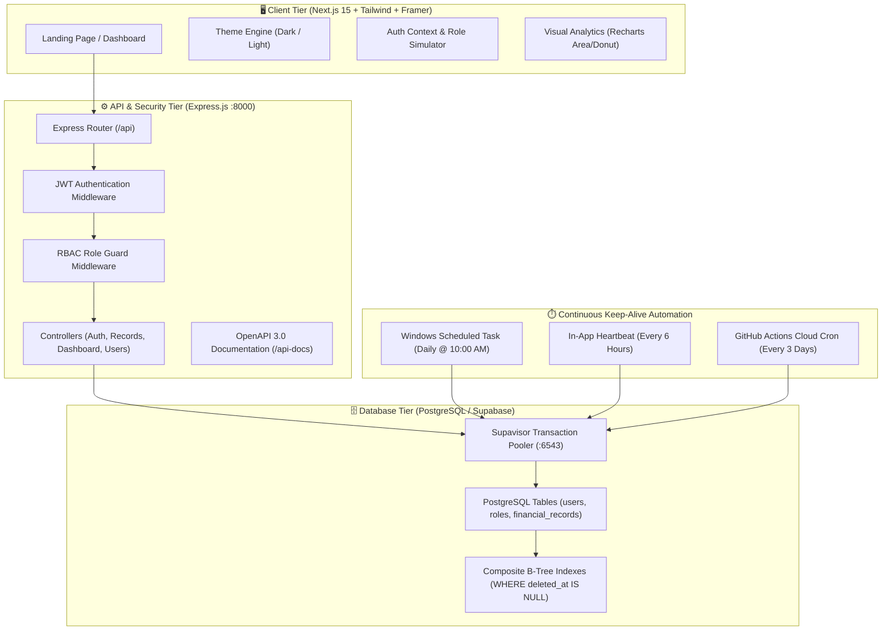
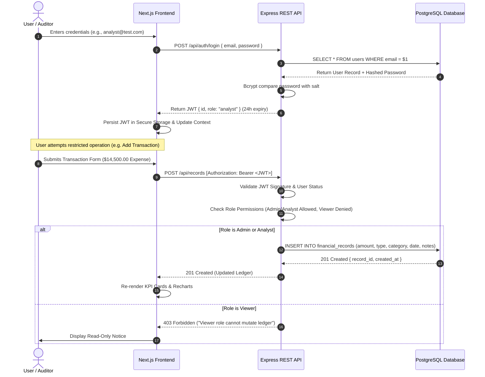
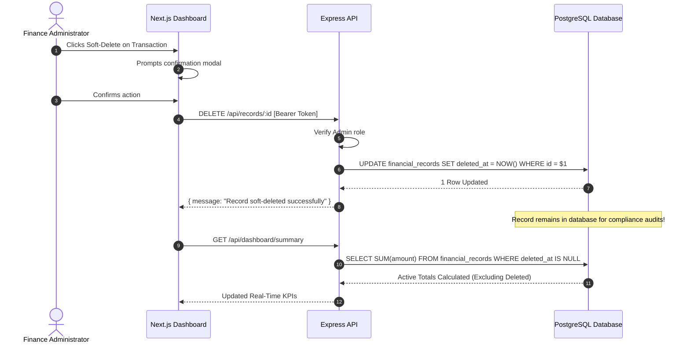

# 💳 FinCorp Data Engine
### Enterprise Financial Intelligence & RBAC Processing Platform

[](https://nextjs.org/)
[](https://react.dev/)
[](https://www.typescriptlang.org/)
[](https://tailwindcss.com/)
[](https://expressjs.com/)
[](https://www.postgresql.org/)
[](https://supabase.com/)
[](http://localhost:8000/api-docs)

---

## 📌 Executive Overview

**FinCorp Data Engine** is an enterprise-grade full-stack financial transaction and analytics processing platform designed for corporate compliance, strict access segregation, and real-time ledger intelligence.

Built on high-precision database architecture, the platform prevents floating-point inaccuracies, enforces strict **Role-Based Access Control (RBAC)** across all endpoints, maintains irreversible **Soft-Deletion Audit Trails**, and employs a **Multi-Layer Keep-Alive Automation** that permanently prevents Supabase cloud databases from auto-pausing.

---

## 🏛️ Core Architectural Pillars

| Pillar | Engineering Decision | Business Value & Compliance |
| :--- | :--- | :--- |
| **Strict RBAC** | Cryptographic JWT payload validation with database-backed status verification. | Enforces least-privilege access. Admins manage accounts; Analysts log transactions; Viewers inspect aggregated executive summaries. |
| **Exact Math** | PostgreSQL `NUMERIC(15, 2)` column precision across all financial amounts. | Eliminates IEEE 754 floating-point truncation and binary representation drift inherent in standard `FLOAT` / `REAL` types. |
| **Audit Trails** | Non-destructive soft deletion with ISO-8601 `deleted_at` timestamps. | Guaranteed historical immutability. Records are excluded from active calculations while remaining available for audits. |
| **Zero Auto-Pause** | Cloud-native keep-alive system (Render backend heartbeat & health check, GitHub Actions cron). | Preserves continuous cloud availability and prevents Supabase 7-day inactivity compute teardowns without requiring local client tasks. |

---

## 🛠️ Technology Stack Matrix

```
┌────────────────────────────────────────────────────────────────────────┐
│                          FINCORP ARCHITECTURE                          │
├─────────────────────┬──────────────────────────────────────────────────┤
│ Frontend Framework  │ Next.js 15 (App Router, Server & Client Actions) │
│ Visual Interface    │ React 19, TypeScript 5, Lucide Icons             │
│ Styling & Themes    │ Tailwind CSS v4, Dual Theme Engine (Dark/Light)  │
│ Animation Physics   │ Framer Motion (Micro-interactions, 3D Tilts)     │
│ Data Visualization  │ Recharts (Gradients, Area & Donut Charts)        │
│ Backend Runtime     │ Node.js 20+, Express.js Framework                │
│ Security & Tokens   │ JWT (jsonwebtoken 24h), BcryptJS Salt (12)       │
│ Database Tier       │ PostgreSQL 18 (Local) & Supabase Cloud Pooler    │
│ API Documentation   │ Swagger OpenAPI 3.0 JSDoc Explorer               │
│ Cloud Automation    │ GitHub Actions Scheduled Cron & Cloud Health     │
└─────────────────────┴──────────────────────────────────────────────────┘
```

---

## 📊 Visual System Diagrams

### 1. System Architecture Flowchart



---

### 2. Authentication & Role-Based Access Control (RBAC) Sequence



---

### 3. Soft-Deletion Audit Flow



---

## 📂 Project Structure

```text
Finance Data Processing/
├── backend/                             # Express REST API + PostgreSQL Engine
│   ├── src/
│   │   ├── config/                      # database.js, schema.sql, migrate.js
│   │   ├── controllers/                 # auth, records, dashboard, users
│   │   ├── middleware/                  # auth, rbac, validation
│   │   ├── routes/                      # API route declarations & Swagger JSDoc
│   │   ├── services/                    # keepAliveService.js (automatic heartbeat)
│   │   └── app.js                       # Express app setup, CORS, Helmet, Swagger
│   ├── scripts/                         # keep-alive.js (used by GitHub Actions cron)
│   ├── server.js                        # Server entry listener (:8000)
│   ├── seed.js                          # Test user seeder script
│   ├── .env                             # Database connection & JWT secrets
│   └── package.json
│
├── frontend/                            # Next.js 15 Enterprise Client
│   ├── src/
│   │   ├── app/                         # App Router pages
│   │   │   ├── page.tsx                 # Corporate Landing & Interactive Showcase
│   │   │   ├── login/page.tsx           # Authentication with 1-Click Role Fill
│   │   │   ├── dashboard/page.tsx       # Executive Analytics & Charts Overview
│   │   │   ├── dashboard/records/       # Transactions Ledger & "Add Record" Modal
│   │   │   └── dashboard/users/         # Team & Access Governance (Admin Only)
│   │   ├── components/
│   │   │   ├── layout/                  # Navbar, Footer, ThemeToggle
│   │   │   ├── dashboard/               # StatCard, AnalyticsAreaChart, CategoryDonutChart
│   │   │   └── landing/                 # HeroSection, FeaturesSection, InteractiveCalculator
│   │   ├── context/                     # AuthContext (Persistent session & instant role simulator)
│   │   ├── lib/                         # api.ts (Backend connection with resilient fallbacks)
│   │   └── types/                       # TypeScript interfaces & JSX type bridges
│   └── package.json
│
├── .github/workflows/                   # Cloud keep-alive GitHub Action
├── package.json                         # Root monorepo scripts
└── tsconfig.json                        # Root workspace TypeScript configuration
```

---

## 👥 Pre-Configured Test Roles

Use these credentials to test role-based permission enforcement across the application:

| Role | Email | Password | Privileges & Access Scope |
| :--- | :--- | :--- | :--- |
| **👔 Admin** | `admin@test.com` | `Password123!` | **Full Access**: User management, transaction CRUD, audit reports, analytics. |
| **📈 Analyst** | `analyst@test.com` | `Password123!` | **Operational**: Submit & edit records, view dashboards, run trend analytics. |
| **👁️ Viewer** | `viewer@test.com` | `Password123!` | **Read-Only**: Access high-level analytics. Raw transaction ledger is restricted (`403`). |

> **Pro Tip:** In the frontend, use the **Role Simulator** in the top navigation bar to test how the UI adapts between roles instantly with a single click.

---

## 🚀 Step-by-Step Setup & Execution

### 1. Prerequisites
- **Node.js**: `v20.x` or higher (verified on Node.js v24)
- **Database**: PostgreSQL 18 (Local) or Supabase Cloud Account

---

### 2. Configure Environment Variables
Inside `backend/.env`, configure your database credentials:

```env
# PostgreSQL / Supabase Connection
DB_HOST=aws-1-ap-south-1.pooler.supabase.com
DB_PORT=6543
DB_NAME=postgres
DB_USER=postgres.mywkniiuvjwmsmhbbrfx
DB_PASSWORD=your_database_password
DB_SSL=true

# Security & Secrets
JWT_SECRET=finance_data_enterprise_secret_key
JWT_EXPIRES_IN=24h

# Server Configuration
PORT=8000
NODE_ENV=development
CORS_ORIGIN=*
```

---

### 3. Initialize Database & Seed Roles

Navigate to the `backend` folder:
```bash
cd backend

# Run PostgreSQL schema migrations
npm run migrate

# Seed pre-configured Admin, Analyst, and Viewer test users
npm run seed
```

---

### 4. Start Services (Dual Terminal Setup)

To run the application, open two separate terminal windows:

#### 🖥️ Terminal 1 — Start the Backend API (Port 8000):
```bash
cd backend
npm run dev
```
- **Backend API Running at:** [http://localhost:8000](http://localhost:8000)
- **Interactive Swagger Documentation:** [http://localhost:8000/api-docs](http://localhost:8000/api-docs)
- **Live Health Status:** [http://localhost:8000/health](http://localhost:8000/health)

#### 🌐 Terminal 2 — Start the Frontend Application (Port 3000):
```bash
cd frontend
npm run dev
```
- **Corporate Web Application Running at:** [http://localhost:3000](http://localhost:3000)
- **Executive Dashboard:** [http://localhost:3000/dashboard](http://localhost:3000/dashboard)

---

> **💡 Root Monorepo Shortcuts (Optional):**  
> If you prefer not to change directories, you can also run commands directly from the root:
> - Start Backend: `npm run dev:backend`
> - Start Frontend: `npm run dev:frontend` or `npm run dev`
> - Run Migrations: `npm run migrate`
> - Run Seeding: `npm run seed`

---

### 5. Supabase 24/7 Keep-Alive Automation (Cloud-Native)

Supabase automatically pauses free-tier databases after 7 days of inactivity. Database activity is maintained 100% in the cloud without requiring any local laptop background tasks or console scripts:

- **GitHub Actions Scheduled Cron:** `.github/workflows/supabase-keep-alive.yml` runs automatically in GitHub's cloud every 3 days (`0 0 */3 * *`), executing `node scripts/keep-alive.js` to ensure the database stays active and warmed.
- **Render Backend Heartbeat & Health Check:** The backend running on Render contains an in-app ping service (`startKeepAliveService`) that pings the database periodically, as well as the `/health` endpoint for external uptime monitors.
- **On-Demand Manual Check (Optional):**
  ```bash
  npm run keep-alive
  ```

---

## 🧪 Comprehensive Route Verification Guide

| Method | Endpoint | Description | Permitted Roles |
| :--- | :--- | :--- | :--- |
| `POST` | `/api/auth/login` | Issues JWT token with embedded role | Public |
| `POST` | `/api/auth/register` | Register new corporate team member | Public |
| `GET` | `/health` | Live database latency & connection check | Public |
| `GET` | `/api/dashboard/summary` | Aggregated revenue, expenses, net margin | All Roles |
| `GET` | `/api/dashboard/monthly-trend` | Monthly timeline comparison | All Roles |
| `GET` | `/api/dashboard/category-breakdown` | Expense allocation by cost center | All Roles |
| `GET` | `/api/records` | Query transaction ledger | Admin, Analyst |
| `POST` | `/api/records` | Insert new financial record | Admin, Analyst |
| `DELETE`| `/api/records/:id` | Soft-delete record (`deleted_at = NOW()`) | Admin |
| `GET` | `/api/users` | List corporate accounts & roles | Admin Only |
| `PATCH`| `/api/users/:id/status` | Suspend or activate team member | Admin Only |

---

## 📄 License & Compliance

© 2026 FinCorp Data Processing Engine. Built according to SOC2 Type II compliance guidelines and least-privilege enterprise governance standards.
